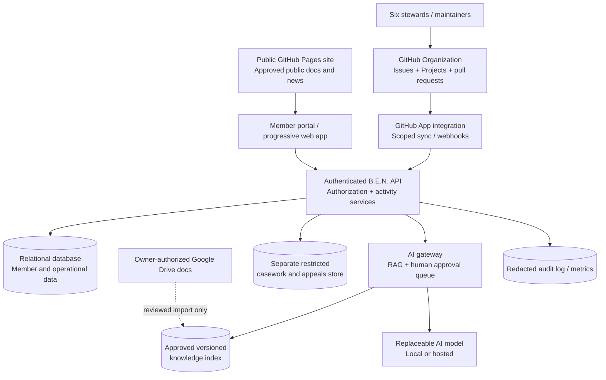

# 04 — Technical architecture and integration contracts

## Core principle: GitHub-first is not GitHub-only

GitHub should own source code, versioned non-sensitive documentation, Issues, Projects, PRs, code review and releases. It is **not** a secure member identity provider for nontechnical participants, a general-purpose private casework database, a payment processor or an authenticated dynamic application host. GitHub Pages is publicly accessible on supported plans even when source repository visibility is private. Use a separately hosted application and managed data store for member functions.



## Bootstrap repository topology

**Stage 0.1.1:** `ORG/ben-os` **private** with existing frontend/server, AI, tests, docs, GitHub integration and all non-sensitive development Issues. `ORG` is a placeholder; no repo creation is assumed. A central organization **GitHub Project** spans it.

**After policy and privacy review:** `ORG/ben-public` **public** for approved Pages content, public principles and anonymous reports; do not expose Google Drive IDs, member rolls or internal workflows. More granular repos (`ben-ai-evals`, `ben-docs`, `ben-infrastructure`) may follow when ownership is clear. Avoid premature split into many repos before the six stewards can maintain them.

**Not GitHub:** live member records, authentication sessions, full decision evidence with personal data, safeguarding case files, consents, bank/payment data, secret keys, recovery codes. Separate authenticated services with tested backups and least privilege.

## Suggested code organization when moving beyond v0.1

```text
/apps/public-web/       Approved public website, accessibility, open knowledge
/apps/member-portal/    Sign-in, participation, personal settings, projects
/apps/steward-console/  Founder and trained steward workflows
/services/api/         REST/typed APIs, RBAC, policy-version checks
/services/workers/     Notifications, queued jobs, integration retries
/services/ai-gateway/  Provider adapters, tool approvals, retrieval
/packages/design/      Accessible purple/gold B.E.N. components
/packages/contracts/   Versioned type definitions, JSON Schemas, event contracts
/packages/ben-values/  Charter version, source registry, AI evaluations
/packages/security/    Authorization, data classification, safe logs
/infra/                Infrastructure-as-code, staging, alarms and restore
/docs/                 ADRs, data model, source-to-requirement traceability
/.github/              Issue templates, CODEOWNERS, CI, security checks
```

Do not migrate every folder in one PR. Preserve v0.1 functionality, add adapters and regression tests first, and make each migration reversible.

## Data and record ownership

| Domain | Canonical master | Who may write | Mirror / projection |
|---|---|---|---|
| Code and planned work | GitHub repositories, Issues, Projects | GitHub scoped maintainers / contributors | Founders' read-only dashboard with source timestamp |
| Policies pre-adoption | Existing owner-controlled Drive master | Authorized human editor | Reviewed version snapshot with PROPOSED label |
| Policies after adoption | Authorized adopted master + signed decision reference | Delegated human authority | Public approved copy and indexed AI knowledge version |
| Decisions, elections, minutes | Restricted governed operations store | Named authorized humans after voting | Sanitised ID/status only in GitHub |
| Member identity, contact, consent | Private membership database | Member or authorized steward within role | Minimal aggregate metrics, never raw member roll in GitHub |
| Safety/appeals | **Separate restricted casework service** | Per-case unconflicted authorized custodians | Randomized case reference and limited workflow status only |
| Event/project participation | Private app DB | Participant, authorized project lead | Non-sensitive project/evidence link in GitHub where approved |
| Grants/finance | Financial system and controlled records | Segregated financial approvers | Public aggregate reports after review |
| AI source and evaluation | Versioned approved corpus and eval artifacts | Knowledge stewards / independent reviewers | Public model card and non-sensitive eval summaries |

## Suggested core entities and relationships

- `User`: opaque id, authentication methods, preferred language, accessibility settings, optional chosen display name, verified eligibility flags (not raw date of birth where unnecessary), deletion state.
- `CommunityMembership`: user_id, joined_at, Code version accepted, status, legal_membership_id **nullable and separate**, optional communications preferences.
- `StewardAssignment`: role, user_id, delegated scope, backup, start/review/end, authorizing decision_id; no role implies additional votes.
- `PolicyVersion`: policy ID, hash, revision, source URL, proposed/adopted/superseded, adoption decision, effective/next review, visibility.
- `ActionProjection`: GitHub issue node ID, org/repo, source timestamp, owner, status, release, next step; synced from provider, not parallel mutable task master.
- `Decision`: opaque id, exact proposal hash/version, category, eligibility basis, quorum/threshold, attendance, recusals, human ratification, audit references, redacted-public-summary reference.
- `Consultation`: question, invited eligibility, open/close, response totals, reasoned summary, decision linkage, consent and accessibility channel.
- `Project`/`Opportunity`: owner, purpose, accessibility, eligibility, location precision, risk tier, capacity, consent plan, verification criteria, review state.
- `VolunteerOffer`/`HelpRequest`/`Match`: voluntary categories, preferred communication mechanism, minimal necessary location, expiry, consent to introductions, safety checks, not moral profile.
- `Event`/`RSVP`: timing/timezone, capacity, accessibility information separated by sensitivity, consent, risk check, cancel authority.
- `Recognition`: opt-in thank-you or project outcome reference; no transferable points, caste, voting power or mandatory contribution threshold.
- `SafetyReference`: random opaque case reference and limited workflow metadata; case narratives/evidence in another store and excluded from model/issue logs.
- `AIConversation`: user consent mode, retention choice, redacted metadata, optional encrypted content; not global personal profiling.
- `AIAnswerProvenance`: answer ID, model/prompt/retriever version, source version and exact cited spans, confidence/unsupported flag, user feedback.
- `AuditEvent`: actor/type/resource, action, source channel, approval ID, timestamp, scoped metadata; append-only and retention-limited.

Use relational constraints, unique IDs, timestamps, tenant/org scopes and explicit soft-delete/retention flows where justified. Do not encode permissions solely in frontend filtering.

## Example service contracts (illustrative, not implemented)

- `GET /v1/public/policies`: approved public metadata only, cache safe, no unpublished links.
- `GET /v1/me`: authenticated member identity, membership status and consent settings.
- `GET /v1/steward/launch-gates`: server checks steward delegation, returns evidence state and authoritative source version.
- `POST /v1/proposals`: creates non-sensitive community proposal, rejects private case narratives, records source-of-truth ID.
- `POST /v1/decisions/{id}/prepare`: prefill eligibility/threshold checklist; no model may cast or confirm votes.
- `POST /v1/ai/ask`: retrieves only authorized corpora, returns exact cite anchors and draft/action flags.
- `POST /v1/ai/actions/{id}/request`: creates bounded proposed action; `approve` requires a named human role and fresh revalidation.
- `POST /v1/privacy/export` and `/erase-request`: user-controlled rights process with human review where legally necessary.
- `/v1/safety/report`: **a separate protected service route**, isolated from standard app/event logs; no automated public webhook with narrative.
- Webhook `/integrations/github`: HMAC-signature verification, event replay detection, queue, idempotent upserts, backoff and dead-letter review.

## Provider integration and sync rules

**GitHub Issues/Projects:** app authorization only to whitelisted repositories; minimal scopes; read-only first. Polling is acceptable for a small pilot before webhooks. Events carry monotonic updated-at version and unique delivery ID; duplicates ignored. On conflict, GitHub Issue/Project remains authoritative for non-sensitive project work. No silently auto-closing tasks in response to AI output. Write operations require explicit owner action.

**Google Drive:** do not bulk-import the archive or restricted folders. A named steward selects a document, checks classification and version, produces a preview diff and records an adoption status. Only after human approval may its approved chunks enter the AI knowledge store. Maintain `source_id`, version, citation spans, hash, reviewer and expiry/review date.

**Discord/chat provider:** integrate only after a founder choice and permission review. Preserve sixteen broad B.E.N. channel categories (from BEN-02) as an information architecture; avoid creating duplicate regional channels or scraping messages to measure membership.

**Payments:** provider-hosted checkout if authorized, webhooks with signature checks, two independent spending approvers, reconciliation, donor privacy and no purchase-based extra voting rights.

## Technology choices (recommendations; interchangeable)

- Frontend: accessible TypeScript web app / PWA; reusable design components; static public site via GitHub Pages where appropriate.
- API: TypeScript Node framework or similarly maintainable, with explicit schemas and a stable API contract. Existing dependency-free Node app should be retained until replaced incrementally.
- Database: portable relational PostgreSQL with role-aware authorization; encrypted backups, migrations, minimal logging.
- Identity: standards-based OIDC/OAuth2 + passwordless/passkey support where accessible; staff MFA, ordinary members not required to join GitHub.
- Jobs: small durable queue for notifications, GitHub events, imports and AI tasks; retries and idempotency.
- AI: adapter for Ollama and approved hosted inference; a restricted retrieval index; structured citations; non-executable tool plan review.
- Storage: separate encrypted object store for user-uploaded materials and tightly restricted casework, with retention and access logs.
- Operations: two environments staging/production, reproducible builds, dependency checks, secret scanning, backup restore and incident procedures.

A model on the founder's laptop cannot provide dependable worldwide access; select hosted inference only after service, cost, energy and privacy review.

## Key architectural decisions (ADRs to open in GitHub)

`ADR-001` Repo topology; `ADR-002` canonical policies and adoption status; `ADR-003` community identity vs legal voting membership; `ADR-004` restricted casework isolation; `ADR-005` hosted database/auth; `ADR-006` inference provider/portability; `ADR-007` human action approvals; `ADR-008` retention/backup; `ADR-009` licence/public contribution; `ADR-010` inclusion/localization; `ADR-011` impact measurement without virtue scores; `ADR-012` audit/event standard. Each requires options, trade-offs, security review, decision owner and rollback.
